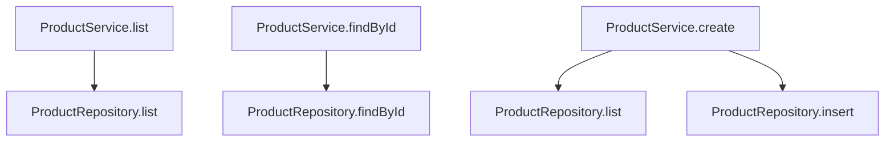

Many people start a service by typing `class ProductService extends` and
working out the rest as they go. A service is an object of related functions
that other code asks for by name, instead of receiving it as an argument.
Starting this way fails in a predictable way. Halfway through, you find that
the error you defined belongs one level down. The dependency you need cannot be
constructed at that point. The method you wrote returns something the caller
cannot use.

This chapter makes every decision on paper and introduces no new API. The
result is a list precise enough that the next two chapters are mostly copying
it into code.

## Start with what calls what

Write only the happy path first. Leave out errors, dependencies and
construction. Show only which operation calls which.



The graph has three public operations and one collaborator. `create` calls
`list` before it inserts, because it must check a rule first. That already
hints at where the rule lives.

The graph is small enough to seem pointless. Draw it anyway. It gives you a
finite list of edges, and you ask each question below once per edge.

## The repository and the service

The catalog needs a place to keep products and a place to decide what the
catalog means. These are different jobs, so they are two different services.

`ProductRepository` owns storage. It can list, find and insert, and it knows
nothing else. If you later replace it with one backed by SQL, none of its
callers change.

`ProductService` owns catalog behaviour. It decides that a missing product is
an error and that a full catalog rejects new products. It also decides what a
caller may ask for.

People get this line wrong more often than any other decision, so here it is
as a rule:

> [!NOTE]
> The repository answers questions. The service decides what the answers mean.

This is why `ProductRepository.findById` returns `Option<Product>` and does
not fail. When you look something up, finding nothing is a valid answer, not a
malfunction. A repository that treated absence as an error would be unusable
for any caller that wants to check whether an id is free.

## Every failure gets exactly one owner

Next, walk the edges and ask what can go wrong.

| Failure | Who produces it | Why there |
| --- | --- | --- |
| The product is not in the catalog | `ProductService.findById` | Absence becomes an error only because this caller asked for a specific product |
| The catalog is full | `ProductService.create` | The limit is a catalog rule, and storage has no such rule |
| The input is not a valid product | the program boundary, before the service | Decoding happens where unknown input arrives |

People most often leave off the third row. Suppose the service took `unknown`
and decoded it. Every method would then carry `SchemaError` for good. Every
caller would handle a parse failure that cannot happen, because the input was
already checked. Decode once, at the boundary. Then the service's signatures
stay about the catalog.

In this design the repository produces no failures. That is honest for an
in-memory store. A SQL repository will gain a storage failure, and the service
will translate it into a catalog failure instead of passing it upward. The
split between the two is already in the right place.

## Write the channels down

Each Effect has three channels, which are its three type slots:

- `A` is the success type.
- `E` is the failure type, also called the error channel.
- `R` is what the Effect needs, also called the requirement channel.

Before you implement each public operation, decide its `A`, `E` and `R`.

| Operation | A | E | R |
| --- | --- | --- | --- |
| `list` | `ReadonlyArray<Product>` | `never` | `ProductService` |
| `findById` | `Product` | `ProductNotFoundError` | `ProductService` |
| `create` | `Product` | `CatalogCapacityError` | `ProductService` |

Written as types, this table is the target for the next three chapters.

```ts twoslash
import { Schema } from 'effect'
const ProductId = Schema.String.pipe(Schema.brand('@Catalog/ProductId'))
type ProductId = Schema.Schema.Type<typeof ProductId>
interface Product {
  readonly id: ProductId
  readonly name: string
  readonly price: number
}
interface CreateProduct {
  readonly name: string
  readonly price: number
}
class ProductNotFoundError extends Schema.TaggedError<ProductNotFoundError>()(
  'ProductNotFoundError',
  { productId: ProductId, message: Schema.String },
) {}
class CatalogCapacityError extends Schema.TaggedError<CatalogCapacityError>()(
  'CatalogCapacityError',
  { maximum: Schema.Finite, message: Schema.String },
) {}
// ---cut---
import { Effect, Option } from 'effect'
type RepositoryFindById = (
  id: ProductId,
) => Effect.Effect<Option.Option<Product>>

type ServiceFindById = (
  id: ProductId,
) => Effect.Effect<Product, ProductNotFoundError>

type ServiceCreate = (
  input: CreateProduct,
) => Effect.Effect<Product, CatalogCapacityError>
```

The first type returns an `Option`. The second does not. That difference is the
design, written down before any code exists. The two error classes do not exist
yet. The next chapter writes `ProductNotFoundError`, and the chapter after it
writes `CatalogCapacityError`. Until then, this block compiles against
stand-ins.

Two entries in the table need a check later.

`findById` succeeds with a `Product`, not an `Option<Product>`. The `Option`
ends at the service. Converting it is the only thing the service adds to that
call.

`R` is `ProductService` alone, not `ProductService | ProductRepository`. The
service needs the repository while it is being built. A layer, which is a
recipe that builds a service, meets that need. Here the service's own layer
does it. Callers never learn that the repository exists. If `R` still mentions
the repository after the [Layers](/learn/basic-effect/07-layers) chapter, the
wiring is wrong.

## Where the values come from

The last pass covers dependencies. For each service, ask what it needs in order
to exist and what it needs on each call.

`ProductRepository` needs storage that outlives a single call, so it creates
its state when it is constructed. Each construction gets its own state, which
keeps two tests independent.

`ProductService` needs the repository and the catalog limit. It reads both
once, when it is constructed, and not on every call. A limit read on every call
can change halfway through a request.

Construction time and call time differ, and you can see the difference in the
code. A value the constructor reads is closed over, so it stays fixed. A value
a method reads is read again on every call.

## What people get wrong

The first mistake is to put an error in the wrong service. A repository that
fails with `ProductNotFoundError` makes a business decision for every future
caller. The next feature that wants to check whether an id is taken then has to
catch an error to find out.

The second mistake is to make everything a service. A service earns its place
when it has a dependency, holds state, or has a second implementation you plan
to write. A function that formats a product name is a plain function. Wrapping
it in `Context.Service` adds a layer to wire and a requirement to satisfy in
every test, and gains nothing.

The third mistake is to design for implementations nobody asked for. The
repository here has three methods because the service calls three methods. It
does not have `update` and `delete` because a repository "should" have them.

The [anti-patterns track](/learn/anti-patterns/04-services-and-layers) covers
these mistakes in more depth, including when the bare key form is the right
one.

## Next

The design is now a list: two services, three public operations, two failures,
one setting and one piece of state. [Services with
Context.Service](/learn/basic-effect/06-services) turns the first half of that
list into code. It builds the pattern from the problem it solves, instead of
presenting a form to fill in.
