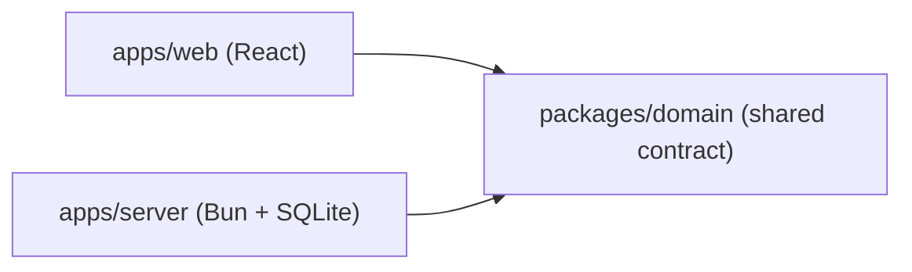

Most full stack apps describe their data twice. The backend has a `Todo` type.
The frontend has its own `Todo` type. The only thing that keeps them the same is
a person who remembers to update both. Rename a field on one side and nothing
complains until a user sees a blank screen.

This track builds a small todo app where that cannot happen. You create every
file yourself, from an empty folder to a page in the browser. Each chapter ends
with a command that proves the step works.

## What you will build

The app does two things: it adds a todo, and it lists all todos. That is small
on purpose. Two features are enough to touch every layer of a real app, and the
todo logic stays out of the way.

The code lives in one repository with three packages:



- `packages/domain` holds the shared pieces: what a todo looks like, and a
  description of the HTTP API.
- `apps/server` reads that description and answers requests. It stores todos in
  a SQLite file.
- `apps/web` is a React page. It reads the same description and gets a fully
  typed client, so nobody writes a `fetch` call or a URL by hand.

The arrows are the only imports allowed. The server and the web page never
import each other. They agree only through `domain`, and TypeScript checks that
agreement every time you build.

## What you need

- [Bun](https://bun.sh). It is the package manager, the server runtime and the
  test runner here.
- A code editor that uses the project's TypeScript version.
- Basic TypeScript and React. You do not need to know Effect. Each Effect idea
  gets a plain explanation the first time it appears, with a link to the
  [Basic Effect](/learn/basic-effect) track if you want more detail.

Every dependency in the `package.json` files is pinned to an exact version, with
no `^` and no `latest`. These versions must not drift:

```sh
effect@4.1.5
@effect/platform-bun@4.1.5
@effect/sql-sqlite-bun@4.1.5
@effect/atom-react@4.1.5
@effect/vitest@4.1.5
typescript@7.0.2
```

Every `effect` and `@effect/*` package shares one version number. If you mix
versions, you get type errors that make no sense. Keep them identical.

Several modules come from paths like `effect/http-api` and `effect/sql`. They
live inside the `effect` package itself. Effect v4 is stable, but its
documentation tags those modules `@stability unstable`. The
[release notes](https://github.com/Effect-TS/effect/releases/tag/effect%404.0.0)
define that tag as "may have breaking changes in minor releases". That is why
the versions above are pinned exactly.

## How the chapters work

Each chapter adds one piece, in the order you would build it for real:

1. [The workspace shape](/learn/fullstack-monorepo/01-the-workspace-shape)
2. [The todo in Schema](/learn/fullstack-monorepo/02-the-todo-in-schema)
3. [Declaring the API as a value](/learn/fullstack-monorepo/03-declaring-the-api)
4. [The repo over SQLite](/learn/fullstack-monorepo/04-the-repo-over-sqlite)
5. [Implementing the handlers](/learn/fullstack-monorepo/05-implementing-the-handlers)
6. [Serving it](/learn/fullstack-monorepo/06-serving-it)
7. [Testing the API](/learn/fullstack-monorepo/07-testing-the-api)
8. [The typed client](/learn/fullstack-monorepo/08-the-typed-client)
9. [The React page](/learn/fullstack-monorepo/09-the-react-page)

The code in every chapter comes from a finished, working repository. When a
file grows over several steps, you see the small version first and the complete
version at the end. What you have then matches the real repository.

Start with [The workspace shape](/learn/fullstack-monorepo/01-the-workspace-shape).
