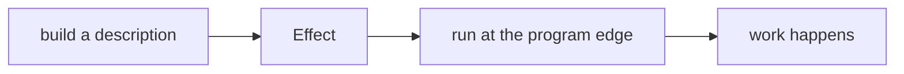

Calling an ordinary async function starts it. This feels so normal that you can
miss what happens: creating the value and starting the work happen at the same
time.

Effect separates those two events. First you describe the work. Later, at the
entry point of the program, you decide to run it.

That split is the first mental shift. Most of the library follows from it.

## Before reading on

What is the value of `started` after the last line?

```ts twoslash
let started = 0

async function calculate(): Promise<number> {
  started += 1
  await Promise.resolve()
  return 42
}

const pending = calculate()
started
// ^?
```

The answer is `1`. Calling `calculate()` ran its body up to the first `await`.
The Promise in `pending` stands for work that is already in progress.

This matters even if nobody awaits `pending`. A network request may have left
the machine. A file may be open. A counter may have changed. By the time you
hold the Promise, it is too late to decide whether the work should start.

## A Promise is a running computation

A Promise tells you that a result will arrive later. It does not keep a reusable
description of how to produce that result.

That is why an operation such as retry needs extra care. Retrying the same
Promise does not repeat the request. The Promise is one particular run. To try
again, you need a function that creates and starts a new one.

```ts twoslash
interface User {
  readonly id: string
}

declare const fetchUser: (id: string) => Promise<User>

const oneRun = fetchUser('u-1')
```

`oneRun` can settle only once. The instructions that created it are not
available as a value. You cannot combine them with other instructions.

Promises are useful when you call JavaScript APIs. Browsers, Node.js, and many
libraries return them. Promises are not broken. A Promise has already decided
when the work starts.

## An Effect is a description

Building an Effect does not run its body.

```ts twoslash
import { Effect } from 'effect'

let started = 0

const calculation = Effect.sync(() => {
  started += 1
  return 42
})

started
// ^?
```

Here `started` is still `0`. `calculation` is a value that describes a
computation. It gives the Effect runtime enough information to perform the
computation later, but it has not performed anything yet.

The difference looks small in code:



It changes what a library can do. Because the description still exists, Effect
can build on it before it runs. It can add a timeout, retry it after a failure,
run it next to another description, or replace a dependency for a test. Each of
these builds a new description. None of them secretly starts the old one.

## Running is a separate decision

A run function hands the description to the runtime.

```ts twoslash
import { Effect } from 'effect'

let started = 0
const calculation = Effect.sync(() => {
  started += 1
  return 42
})

const answer = Effect.runSync(calculation)
//    ^?
```

Now `started` is `1`, and `answer` is `42`.

Do not memorize `runSync` yet. Basic Effect covers the run functions and when to
use each one. For now, remember this split:

- most of the program builds and combines descriptions.
- one place near the entry point supplies what the descriptions need and runs
  them.

Calling a run function in the middle of the program breaks this split. You get
a result back, but Effect can no longer see or build on the work you just ran.

## What to remember

An Effect is not the success value, and it is not work in progress. It is a
value that describes work. The work may later succeed, fail, or need something
from its environment.

For now, ask one question whenever you see an Effect: "Has this run yet?" Unless
it has reached a run function at the entry point, the answer is no.

Next, [Failure is a value](/learn/mental-model/02-failure-is-a-value) applies
the same idea to errors. Effect keeps a failure in the description, so it stays
in the type.
