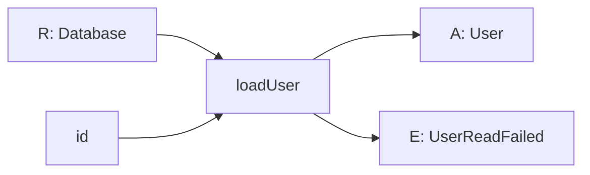

A function can have a simple signature and still depend on a database, the
clock, environment variables, or a global HTTP client. Those dependencies live
in its body, usually behind imports.

The function works, but its type shows only part of what it does. You can see
what goes in and what comes out. You cannot see what must exist for the
function to do its job.

Effect records these dependencies in the `R` channel.

## Before reading on

Assume this declaration came from a module you have not opened:

```ts twoslash
interface User {
  readonly id: string
  readonly name: string
}

declare const loadUser: (id: string) => Promise<User>
```

Could you call it in a unit test without a database? Does it read the current
time? Will it send an HTTP request? Does it depend on a module-level cache?

The signature cannot answer. An `id` goes in and a Promise of `User` comes out.
Everything it needs in between is hidden.

Reading the body may show the dependencies. But callers should not have to read
the implementation to know what a function needs.

## Imports pick the dependency early

Imports are not the problem by themselves. Importing types, constants, and pure
helpers is ordinary module design.

The trouble starts when an import picks a stateful dependency for the whole
module. Say `loadUser` imports one database client directly. Then production and
tests both get that client, unless the test runner replaces the module.

That leads to familiar workarounds: module mocks, patched globals, reset hooks,
and rules about import order. These tests work around a decision that the
function's type never showed.

You can pass every dependency as a normal argument. That makes each one visible,
but it also forces functions that do not use a dependency to pass it along.
Dependency containers hide this passing, but they often move the list of
dependencies into runtime configuration.

Effect does it differently. The dependencies stay in the program's type, and you
supply their values separately.

## The R channel is what the program needs

Read the three channels as one sentence:

```text
Effect<A, E, R>
```

The program may succeed with `A`, may fail with `E`, and needs `R` before it can
run.

A database dependency can look like this:

```ts twoslash
import { Context, Effect } from 'effect'

interface User {
  readonly id: string
  readonly name: string
}

declare class UserReadFailed {
  readonly _tag: 'UserReadFailed'
}

class Database extends Context.Service<
  Database,
  {
    readonly readUser: (
      id: string,
    ) => Effect.Effect<User, UserReadFailed>
  }
>()('app/Database') {}

declare const loadUser: (
  id: string,
) => Effect.Effect<User, UserReadFailed, Database>
```

Ignore how `Database` is declared for now. Look at the last line. `loadUser`
cannot run with an ID alone. Someone must also provide a `Database`. You can see
this without opening the function.



When you combine programs, their dependencies combine too. If a later step needs
a clock, the larger program's `R` contains both `Database` and `Clock`. You do
not keep that list by hand. The type tracks what the program uses.

## You choose the implementation at the entry point

Describing a dependency and choosing its implementation are separate jobs. The
`loadUser` program says, "I cannot load a user without a database." Code near
the application entry point decides which database implementation to provide.

A test can provide an in-memory implementation. Production can provide one
backed by a real server. The program in between does not change, and neither do
its success and failure types.

Now a test only has to answer one question: "What should this dependency do in
this case?" It does not have to replace a module that was chosen before the test
started.

When you have supplied every dependency, `R` becomes `never`. Here, `never`
means the program needs nothing else from its environment. It is ready for a run
function.

Basic Effect teaches services, layers, and the APIs that provide them. For now,
remember this: a program needs its dependencies whether or not the type shows
them. Hiding one in the body does not remove it.

## What to remember

Before you read the body of an Effect function, read `R`. It answers, in the
type, a question that ordinary code leaves to setup notes: "What must exist
before this can work?"

Then ask whether each dependency belongs in `R`. A database, a clock, or an HTTP
client has behavior you may want to replace. A pure formatting function usually
does not. If you put every helper into `R`, you add extra work and gain no
useful choice.

Next, [Unlearning try, catch and await](/learn/mental-model/04-unlearning-the-keywords)
puts descriptions, failures, and dependencies into one map.
